<p align="center">
  
</p>

<h1 align="center">Argos Monitor</h1>

<p align="center">
  <strong>Open-source multilingual media &amp; crisis intelligence monitor for foreign-affairs analysts</strong><br>
  <em>Deterministic ONNX embedding clustering · Syndication deduplication · State-media tagging · Domestic blind-spot detection · Zero LLM hallucinations</em>
</p>

<p align="center">
  <a href="https://argos-monitor.pages.dev"><strong>Live Platform (argos-monitor.pages.dev)</strong></a> ·
  <a href="https://argos-monitor.pages.dev/about.html">Methodology</a> ·
  <a href="https://argos-monitor.pages.dev/sources.html">Source Directory</a> ·
  <a href="https://github.com/gergkar-gif/argos-monitor/actions/workflows/daily.yml"></a>
</p>

---

## Overview

**Argos Monitor** (created by **Károly Gergely**) is an automated open-source media and crisis intelligence platform built for foreign-desk officers, country analysts, and researchers.

Unlike LLM-based news summarizers—which risk hallucinated claims, flattened diplomatic nuance, or unattributed spin—Argos operates on a strict **evidence-first** architecture:

1. **No source, no statement:** Every headline and pull-quote on the platform is extracted verbatim and verified character-for-character as an exact substring of the stored source article.
2. **Zero LLM in the pipeline:** Event clustering, cross-lingual topic classification, policy-theme scoring, and quote selection are 100% deterministic, powered locally by ONNX Runtime (`intfloat/multilingual-e5-small`).
3. **Independent outlet counting:** State wire reprints and syndicated copies (cosine similarity $\ge 0.95$) are collapsed so 20 reprints of a single wire dispatch never masquerade as 20 independent confirmations.
4. **Domestic press blind-spot detection (`NOT IN DOMESTIC PRESS`):** Stories covered by international wires or local-language diaspora outlets abroad that receive zero coverage inside the country's domestic press are automatically flagged.
5. **State-affiliation transparency (`OFFICIAL` vs. `REPORTED`):** Every monitored outlet is catalogued by ownership, governing body, and state/party affiliation so official government statements are immediately distinguishable from independent reporting.

---

## Architecture & 10-Stage Pipeline

A scheduled GitHub Actions workflow runs every 3 hours, updating the SQLite store and publishing static JSON/JS data bundles to Cloudflare Pages:

```mermaid
flowchart LR
    A["01 · Ingest<br/>120+ RSS & Google News feeds"] --> B["02 · Extract<br/>Trafilatura full-text"]
    B --> C["03 · Normalise<br/>Unicode NFC"]
    C --> D["04 · Relevance<br/>Section & mention gate"]
    D --> E["05 · Embed<br/>ONNX multilingual-e5-small"]
    E --> F["06 · Cluster<br/>Agglomerative + copy dedup"]
    F --> G["07 · Classify<br/>Bilingual topic anchors"]
    G --> H["08 · Policy & Rank<br/>themes.yaml + outlet diversity"]
    H --> I["09 · Verify<br/>Substring-verified excerpts"]
    I --> J["10 · Signals & Export<br/>Crisis alerts, Trends, Reddit"]
```



| Stage | Module | Description |
| :--- | :--- | :--- |
| **01 · Ingest** | [`argos/ingest.py`](argos/ingest.py) | Polls domestic, diaspora (`abroad_local`), and international RSS/Atom feeds per country pack. |
| **02 · Extract** | [`argos/extract.py`](argos/extract.py) | Fetches full article text via Trafilatura and resolves syndicated publisher names. |
| **03 · Normalise** | [`argos/normalise.py`](argos/normalise.py) | Applies Unicode NFC normalisation across all text fields (essential for Vietnamese diacritics and Khmer script). |
| **04 · Relevance** | [`argos/relevance.py`](argos/relevance.py) | Filters out lifestyle/sport noise and enforces country-mention rules on general international feeds. |
| **05 · Embed** | [`argos/embed.py`](argos/embed.py) | Encodes headlines and leads into 384-d vectors via ONNX Runtime (`intfloat/multilingual-e5-small`). |
| **06 · Cluster** | [`argos/cluster.py`](argos/cluster.py) | Two-pass agglomerative cosine clustering into event stories, flagging near-duplicate reprints ($\ge 0.95$) and related clusters. |
| **07 · Classify** | [`argos/classify.py`](argos/classify.py) | Assigns stories to 6 policy desks (`Internal politics`, `Economy`, `Foreign policy`, `Defence & security`, `Society`, `Other`) using feed hints + bilingual anchor embeddings. |
| **08 · Policy & Rank** | [`argos/policy.py`](argos/policy.py), [`argos/rank.py`](argos/rank.py) | Scores stories by foreign-desk priority themes (`themes.yaml`), independent outlet count, scope diversity, and recency. |
| **09 · Excerpts & Verify** | [`argos/excerpts.py`](argos/excerpts.py), [`argos/verify.py`](argos/verify.py) | Selects informative sentences and asserts each excerpt is a verbatim substring of the source article. |
| **10 · Signals & Export** | [`argos/crisis.py`](argos/crisis.py), [`argos/trends.py`](argos/trends.py), [`argos/reddit.py`](argos/reddit.py), [`argos/export.py`](argos/export.py) | Integrates GDACS/USGS disasters, UK FCDO & US State Dept travel advisories, Google Trends, and policy-filtered Reddit discussions into static bundles. |

---

## Declarative Country Pack System

Each monitored country is defined declaratively in `countries/<id>/` with zero code changes required to onboard a new desk:

- **`pack.yaml`** — ISO codes, primary language, country-mention terms, URL section classifier rules, bilingual topic anchor descriptions, and monitored subreddits.
- **`sources.yaml`** — Curated media directory across three scopes (`domestic`, `abroad_local`, `international`) with ownership metadata and `state_affiliated` flags.
- **`themes.yaml`** — Bilingual foreign-desk priority themes, weights, keywords, and semantic descriptions tailored to the country's geopolitical fault lines.

### Currently Active Country Packs (28 Countries across 9 Regional Desks)

- **Southeast Asia (7 Desks):**
  - **Vietnam** (`countries/vietnam/`) — Domestic state/party press, overseas Vietnamese media, and international wires (`vi` / `en`).
  - **Cambodia** (`countries/cambodia/`) — Khmer and English domestic press, exile/diaspora coverage, and regional ASEAN reporting (`km` / `en`).
  - **Thailand** (`countries/thailand/`) — Thai and English national press, independent civic outlets (*Prachatai*), and regional coverage (`th` / `en`).
  - **Myanmar** (`countries/myanmar/`) — State/domestic coverage contrasted against independent Burmese outlets in exile (*The Irrawaddy*, *Myanmar Now*, *DVB*, *BNI*) and international wires (`my` / `en`).
  - **Philippines** (`countries/philippines/`) — Major national dailies (*Rappler*, *Inquirer*, *Philstar*, *GMA*, *BusinessWorld*, *Manila Times*), state wire (*PNA*), and West Philippine Sea security coverage (`en`).
  - **Indonesia** (`countries/indonesia/`) — State wire (*ANTARA* in Indonesian & English), financial press (*CNBC Indonesia*), and national/international coverage (`id` / `en`).
  - **Malaysia** (`countries/malaysia/`) — National and financial dailies (*Free Malaysia Today*, *Malay Mail*, *The Star*, *New Straits Times*, *The Edge*), state agency (*BERNAMA*), and ASEAN regional reporting (`ms` / `en`).
- **Central Europe (3 Desks):**
  - **Hungary** (`countries/hungary/`) — Pro-government and independent domestic outlets, cross-border Hungarian press, and EU/international coverage (`hu` / `en`).
  - **Poland** (`countries/poland/`) — State wire (*PAP*), major independent/commercial broadcasters (*RMF24*, *TVN24*, *Polsat*), investigative press (*OKO.press*), and English briefers (*Notes from Poland*) (`pl` / `en`).
  - **Slovakia** (`countries/slovakia/`) — Independent Bratislava dailies (*Denník N*, *Aktuality.sk*, *Pravda*, *The Slovak Spectator*), state wire/broadcaster (*TASR* / *STVR*), and Czech/Visegrád coverage (`sk` / `en`).
- **Balkans (3 Desks):**
  - **Serbia** (`countries/serbia/`) — Public broadcaster (*RTS*) alongside independent national & regional investigative outlets (*N1*, *Danas*, *Nova.rs*, *Južne vesti*, *Autonomija*) (`sr` / `en`).
  - **Bosnia and Herzegovina** (`countries/bosnia/`) — Investigative centers (*CIN*, *Istraga.ba*), daily paper of record (*Oslobođenje*), state wire (*FENA*), and regional Balkan coverage (*Al Jazeera Balkans*, *RFE/RL*) (`bs` / `en`).
  - **Kosovo** (`countries/kosovo/`) — Paper of record (*Koha Ditore*), public broadcaster (*RTK*), digital media (*Gazeta Express*, *Kallxo*), and North Mitrovica local coverage (*KoSSev*) (`sq` / `sr` / `en`).
- **Eastern Europe (1 Desk):**
  - **Moldova** (`countries/moldova/`) — Investigative & independent Chișinău press (*Ziarul de Gardă*, *NewsMaker*, *Deschide.md*), state wire (*Moldpres* / *TRM*), and Romanian/EU regional coverage (`ro` / `en`).
- **South Caucasus (3 Desks):**
  - **Georgia** (`countries/georgia/`) — Bilingual independent daily (*Civil.ge* in Georgian & English), Caucasus investigative outlets (*OC Media*, *JAMnews*), and official government press (`ka` / `en`).
  - **Azerbaijan** (`countries/azerbaijan/`) — Official/pro-government Baku wires (*AZERTAC*, *Trend*, *APA*) contrasted against exiled independent outlets (*Meydan TV* in Azerbaijani & English, *OC Media*) (`az` / `en`).
  - **Armenia** (`countries/armenia/`) — Investigative & independent Yerevan outlets (*Hetq* in Armenian & English, *Factor.am*, *CivilNet*), state wire (*Armenpress*), and Caucasus regional press (`hy` / `en`).
- **Central Asia (3 Desks):**
  - **Kazakhstan** (`countries/kazakhstan/`) — State-backed daily (*The Astana Times*), business & national press (*Kursiv Media* in Russian & English, *Tengrinews*), and regional coverage (*The Times of Central Asia*) (`ru` / `en`).
  - **Uzbekistan** (`countries/uzbekistan/`) — Tashkent digital dailies (*Gazeta.uz*, *Kun.uz*, *Daryo*), state wire (*UzA*), and exiled/regional coverage (*RFE/RL Ozodlik*, *The Times of Central Asia*) (`uz` / `en`).
  - **Kyrgyzstan** (`countries/kyrgyzstan/`) — Independent investigative & digital outlets (*Kloop*, *24.kg*, *Kaktus.media*), state news agency (*Kabar*), and regional/exile coverage (*RFE/RL Azattyk*) (`ky` / `ru` / `en`).
- **Middle East & Mediterranean (1 Desk):**
  - **Turkey** (`countries/turkey/`) — State wire & pro-government press (*Anadolu Agency*, *Daily Sabah*) contrasted with independent/opposition dailies (*Cumhuriyet*, *Sözcü*, *BirGün*, *Bianet*) and diaspora coverage (`tr` / `en`).
- **Sub-Saharan Africa (4 Desks):**
  - **South Africa** (`countries/south_africa/`) — Domestic national press, regional African outlets, and international coverage (`en`).
  - **Ethiopia** (`countries/ethiopia/`) — State-affiliated broadcaster (*Fana BC*) alongside independent Addis Ababa weeklies (*The Reporter*, *Capital Ethiopia*, *Ethiopian Monitor*) and diaspora/regional press (*Addis Standard*, *Borkena*) (`en`).
  - **Nigeria** (`countries/nigeria/`) — National dailies & broadcasters (*Premium Times*, *The Punch*, *Vanguard*, *Channels TV*), state wire (*NAN*), and diaspora investigative press (*Sahara Reporters*) (`en`).
  - **Kenya** (`countries/kenya/`) — National daily paper of record (*The Standard*), public broadcaster (*KBC*), major national press (*Daily Nation*, *The Star*), and regional East African media (*The EastAfrican*) (`en`).
- **South America (3 Desks):**
  - **Brazil** (`countries/brazil/`) — Federal public agency (*Agência Brasil*) alongside major political and financial dailies (*Folha de S.Paulo*, *Poder360*, *G1*, *InfoMoney*, *Nexo*) (`pt` / `en`).
  - **Colombia** (`countries/colombia/`) — Independent political & investigative press (*La Silla Vacía*, *Colombia Reports*, *El Tiempo*, *El Espectador*, *Semana*), official *Presidencia / RTVC*, and regional security press (*InSight Crime*) (`es` / `en`).
  - **Argentina** (`countries/argentina/`) — National papers of record and digital dailies (*Infobae*, *La Nación*, *Clarín*, *Ámbito Financiero*), official communications, and regional Latin American press (`es` / `en`).

---

## Running Locally

### 1. Install dependencies
```powershell
python -m pip install -r requirements.txt
```

### 2. Verify environment & download ONNX model
```powershell
python setup_check.py
```
Creates the local SQLite & model directory (`C:\ArgosData` by default, or set via `ARGOS_DATA_DIR`) and verifies dependencies.

### 3. Run the full pipeline (or individual stages)
```powershell
python run.py
# Or run specific stages:
python run.py crisis trends reddit export
```

### 4. View the site
Open `site/index.html` directly in any browser (works over `file://`), or launch the local development server:
```powershell
python serve.py
```

---

## Author & License

Created and maintained by **Károly Gergely**.  
Released under the [MIT License](LICENSE).
